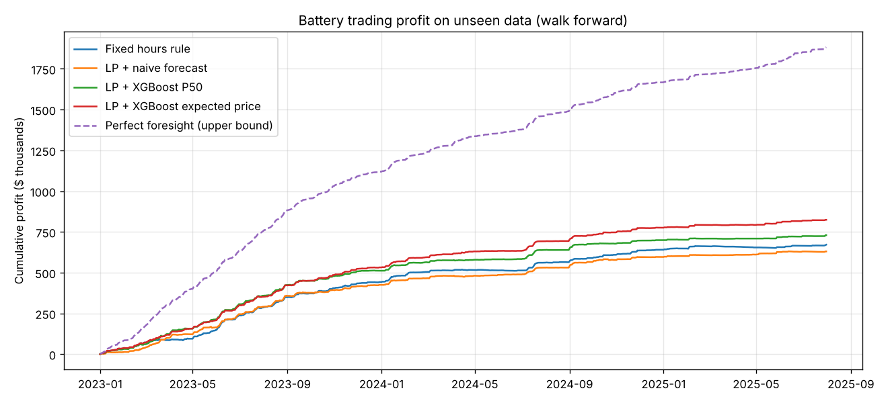
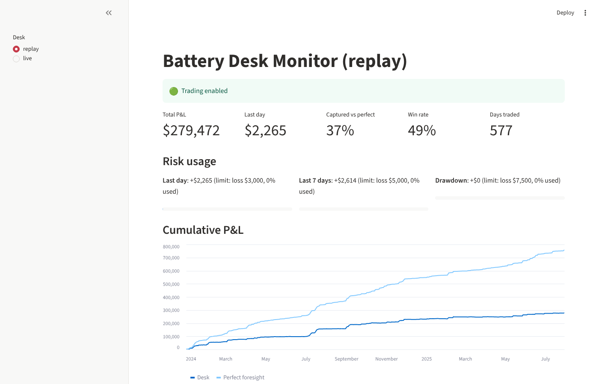

# Alberta Battery Trading Agent

An AI agent that trades a virtual grid battery in Alberta's electricity market.
Every midnight it forecasts the next 24 hourly pool prices, decides when to
charge and when to sell with a linear program, and is settled at the real
prices. Tested walk forward on 2.5 years of AESO data it never trained on.

Alberta's pool price is one of the most volatile in the world ($0 to the
$999.99/MWh cap), which makes it a hard forecasting problem and a real
trading opportunity.

```
AESO data ──► clean + SQLite ──► features ──► XGBoost forecasts ──► LP optimizer ──► backtest ──► dashboard
              stage 1             stage 2      P10/P50/P90, mean,    stage 3          stage 4
                                               spike probability
```

## Headline results (Jan 2023 to Jul 2025, 943 unseen days)

| | Fixed hours rule | **LP + XGBoost expected price** | Perfect foresight |
|---|---|---|---|
| Profit (10 MWh / 5 MW battery) | $671k | **$824k (+23%)** | $1.88M |
| Share of maximum possible | 36% | **44%** | 100% |
| Sharpe ratio (annual) | 7.5 | **8.4** | 15.7 |
| Max drawdown | $11.8k | **$4.4k** | 0 |

Forecasts: XGBoost cuts price error **24%** vs "tomorrow = today" ($55.76 vs
$72.94/MWh MAE) and catches **70%** of the 1,494 spike hours above $300.
Full details and charts: [reports/RESULTS.md](reports/RESULTS.md).



## Quick start

```bash
python -m venv .venv
.venv\Scripts\activate             # Mac/Linux: source .venv/bin/activate
pip install -r requirements.txt

python scripts/download_data.py    # AESO hourly price + load, 2010 to Jul 2025
python scripts/build_dataset.py    # clean, validate, save data/processed/market.db
python scripts/explore.py          # 4 exploration charts in reports/
python scripts/train_forecast.py   # walk forward forecasts (about 10 minutes)
python scripts/run_backtest.py     # trade the battery, print profit and risk
streamlit run app/dashboard.py     # interactive dashboard
python scripts/desk.py replay --start 2024-01-01 --end 2024-03-31   # the desk, see below
pytest                             # 28 tests
```

## How it works

### Stage 1: data (`src/powerbot/data.py`)
Reads AESO's hourly files, keeps timestamp, pool price and Alberta Internal
Load, and validates them: bad timestamps, daylight saving duplicates, prices
outside AESO's $0 to $999.99 limits, and missing hours (gaps of 3 hours or
less are interpolated, longer gaps are left empty). Result: 136,584 clean
hours, every day complete.

### Stage 2: forecasting (`features.py`, `forecast.py`)
The decision for day D is made at midnight, so every feature must be known
by then:

* calendar: hour, weekday, month, weekend, cyclical hour
* lags of 24, 48 and 168 hours for price and load (never 1 hour: at midnight
  we don't know the 4 PM price yet)
* yesterday's daily mean, max, min, volatility and spike count, plus 7 day
  averages, all shifted one full day

Models (XGBoost):

| Model | Output | Why |
|---|---|---|
| Naive baseline | today's price at the same hour | the number to beat |
| Quantile regression | P10, P50, P90 | a range, not one guess |
| Mean regression | expected price | what a risk neutral trader should plan on (spikes pull the mean above the median) |
| Classifier | probability price > $300 | spikes are where Alberta's money is |

**Walk forward testing:** for each month from Jan 2023, retrain on everything
before that month and predict that month. No random splits, no future data.

### Stage 3: trading (`battery.py`)
Battery: 10 MWh, 5 MW, 90% round trip efficiency, $10/MWh wear cost, at most
one full cycle per day, starts and ends each day empty.

Each day a linear program (scipy HiGHS) chooses 24 charge and discharge values
to maximize forecast profit minus wear, subject to power limits, energy
balance with losses, and the state of charge staying between empty and full.
The plan is then **settled at actual prices**.

### Stage 4: backtest (`backtest.py`)
Strategies compared on the same days:

* **Fixed hours rule:** charge the cheapest 3 night hours, sell the priciest 3
  evening hours, both picked from training data only
* **LP + naive forecast**
* **LP + XGBoost P50**
* **LP + XGBoost expected price**
* **Perfect foresight:** LP on the real prices, the upper bound no one can beat

Metrics: total profit, $/kW per year, % of perfect foresight captured,
annualized Sharpe ratio of daily P&L, max drawdown, average of the worst 5%
of days, and share of losing days.

## The trading desk (`src/powerbot/desk/`)

The backtest answers "would this have worked?". The desk is the system that
runs it every day as if it were live, with the controls a real trading desk
has. It runs in two modes with identical code: **replay** (history, released
one day at a time) and **live paper trading** (AESO API, simulated money).

```
               ┌──────────── daily cycle, 00:10 ────────────┐
 AESO API ──►  │ 1 INGEST   new hours, cleaned, quality checked │
 (or replay)   │ 2 SETTLE   pay yesterday's plan at real prices │
               │ 3 RISK     loss limits ──► kill switch         │──► alerts (log + Discord)
               │ 4 MODEL    retrain monthly, versioned          │
               │ 5 CHECKS   fresh data? current model?          │
               │ 6 FORECAST P10/P50/P90, mean, spike odds       │
               │ 7 OPTIMIZE LP + spike overlay (no risky buys)  │
               │ 8 VERIFY   independent physics check           │
               │ 9 RECORD   plan + reasons ──► ledger + audit   │──► desk monitor
               └────────────────────────────────────────────────┘
```

| Component | File | What a desk uses it for |
|---|---|---|
| Market data feeds | `feeds.py` | AESO API client (`API-KEY` header) and a replay feed that physically cannot return future hours |
| Ledger | `ledger.py` | SQLite book of record: market data, plans, daily P&L, audit log, state |
| Model ops | `model_store.py` | trains, saves and versions models; every plan records which model made it |
| Risk | `risk.py` | pre trade checks, spike overlay, daily/weekly/drawdown loss limits |
| Kill switch | `engine.py` | trips automatically on a limit breach; only a human can reset it |
| Alerts | `alerts.py` | every event to `logs/`, plus Discord to your phone if configured |
| Engine | `engine.py` | the 9 step daily cycle, every step written to the audit log |
| Monitor | `app/desk_monitor.py` | kill switch, P&L, risk usage bars, latest plan, audit log |

**Risk limits** (sized just beyond the worst backtest outcomes):

| Limit | Value | Action |
|---|---|---|
| Daily loss | $3,000 | kill switch |
| 7 day loss | $5,000 | kill switch |
| Drawdown from peak | $7,500 | kill switch |
| Spike probability > 50% | per hour | battery may not buy in that hour |
| Expected profit < $50 | per day | stay idle, not worth the wear |
| Stale data or gaps in last 8 days | per day | skip the day |
| Model older than 45 days | per day | skip the day |
| Plan fails physics check | per day | skip and alert HALT |

### Desk replay results (Jan 2024 to Jul 2025, 577 days, run as if live)

| | Backtest (no risk controls) | **Desk (with risk controls)** |
|---|---|---|
| Profit | $291,967 | **$279,472** |
| Perfect foresight (same days) | $759,529 | $759,529 |
| Max drawdown | $3,219 | **$2,979** |
| Losing days | 49% | **46%** |
| Days idle (not worth trading) | 0 | 28 |
| Models trained | n/a | 19 (one per month, versioned) |
| Kill switch trips | n/a | 0 |

The perfect foresight number matches to the dollar, so the desk's settlement
agrees exactly with the independent backtest. The risk controls gave up 4% of
profit for a smaller drawdown and fewer losing days, the usual trade a desk
makes. Both beat the fixed hours rule ($226,387 on the same days) by over 23%.



### Run the desk

```bash
# rehearse on history (no API key needed)
python scripts/desk.py replay --start 2024-01-01 --end 2024-03-31
python scripts/desk.py status --replay
streamlit run app/desk_monitor.py

# live paper trading
setx AESO_API_KEY "your-key"          # Windows; open a NEW terminal after this
python scripts/desk.py init           # once
python scripts/desk.py run            # one daily cycle
powershell -ExecutionPolicy Bypass -File scripts\schedule_windows.ps1   # run daily at 00:10

# operations
python scripts/desk.py kill --reason "investigating forecast"
python scripts/desk.py resume --note "checked, data was fine"
```

Optional phone alerts: create a Discord webhook (Server Settings, Integrations,
Webhooks) and `setx DISCORD_WEBHOOK_URL "https://discord.com/api/webhooks/..."`.

### Getting an AESO API key
Sign up at https://developer-apim.aeso.ca/, verify your email, then Products,
AESO Public API, Subscribe. The key is under your Profile. Never commit it;
it lives only in the `AESO_API_KEY` environment variable.

## Tests (`tests/`)
* lags point exactly where they should, and lags under 24 hours are refused
* **no look ahead:** changing day D's prices does not change any of day D's features
* battery never breaks power, capacity, cycle or end of day limits
* battery stays idle when the spread doesn't cover losses and wear
* perfect foresight always beats any fixed plan
* desk: the replay feed never shows the future, AESO responses parse
  (including unsettled hours and bad keys), quality checks catch gaps, the
  physics check catches broken plans, loss limits trip, the kill switch blocks
  trading until resumed, stale data skips the day, and a full 3 day cycle
  plans, settles and logs every step

28 tests run on every push via GitHub Actions (`.github/workflows/ci.yml`).

## Limitations (say these before an interviewer does)
* **Price taker:** assumes a 5 MW battery doesn't move the pool price. True for
  small assets, not for large fleets.
* **Energy only:** real Alberta batteries earn most of their money from
  operating reserves, not arbitrage. That's the next extension.
* **Day ahead decisions only:** a real operator can update the plan during the
  day as new information arrives.
* **No transmission charges or market fees** in the profit numbers.
* **Market rules are changing:** Alberta's Restructured Energy Market (REM) is
  being implemented through 2027 and 2028, which will change price behaviour.

## Roadmap
1. Add AESO wind and solar forecasts as features (point in time vintages)
2. Co optimize energy arbitrage with operating reserves
3. Intraday re optimization as new prices arrive
4. Calibrate the P10 to P90 ranges (conformal prediction)
5. C++ optimizer core benchmarked against Python
