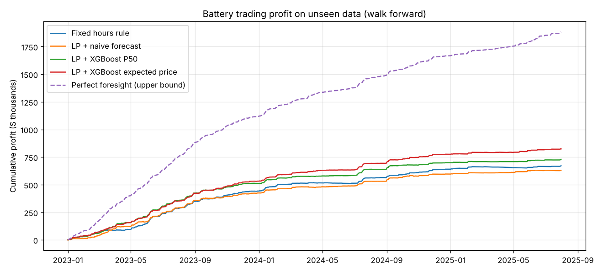
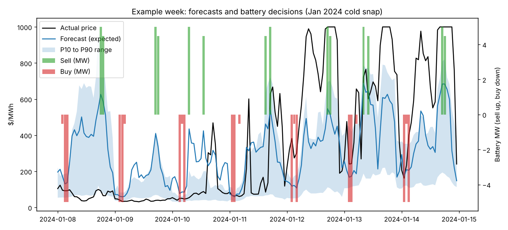
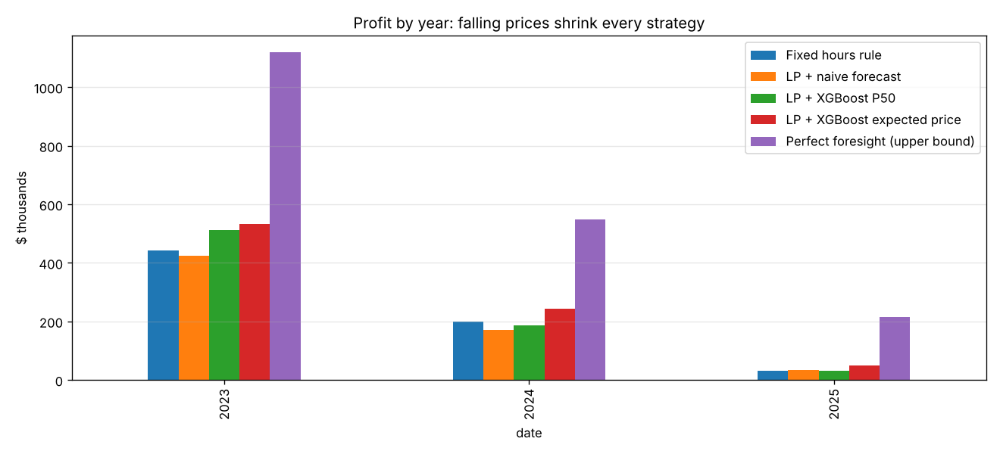

# Results

Test period: 2023-01-01 to 2025-07-31 (943 days), never seen during training. Models retrained every month.
Battery: 10 MWh, 5 MW, 90% round trip efficiency, $10/MWh wear cost, max 1 cycle per day.

## Forecast accuracy

| Metric | Naive | XGBoost |
|---|---|---|
| Mean absolute error ($/MWh) | 72.94 | 55.76 (23.6% better) |
| Hour ranking accuracy (Spearman) | 0.18 | 0.29 |
| Actual price inside P10 to P90 | | 65.0% (target 80%) |
| Spike hours (> $300) caught | | 70% of 1494 (precision 21%) |

## Trading results

| Strategy | Profit | $/kW per year | % of perfect | Sharpe | Max drawdown | Worst 5% days (avg) | Losing days |
|---|---|---|---|---|---|---|---|
| Fixed hours rule | $671,390 | $52 | 36% | 7.5 | $-11,787 | $-1,143 | 45% |
| LP + naive forecast | $630,115 | $49 | 33% | 7.0 | $-6,961 | $-1,429 | 48% |
| LP + XGBoost P50 | $729,858 | $57 | 39% | 7.9 | $-4,229 | $-1,115 | 32% |
| LP + XGBoost expected price | $824,273 | $64 | 44% | 8.4 | $-4,409 | $-978 | 43% |
| Perfect foresight (upper bound) | $1,882,818 | $146 | 100% | 15.7 | $0 | $14 | 0% |

Best real strategy: **LP + XGBoost expected price**.

